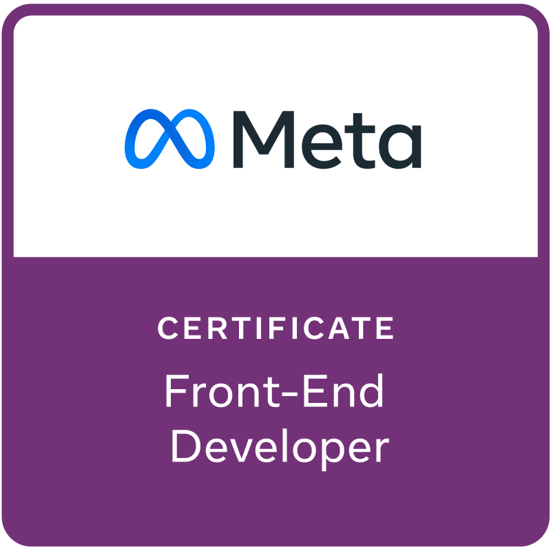

 

**Software Engineer & Founder at Megicode**

 

  

&nbsp;

---

## 👨‍💻 About Me

I'm a **Software Engineer** from Lahore, Pakistan, completing my BSc in Software Engineering at **COMSATS University Islamabad**. I founded **[Megicode](https://megicode.com)** and built **CampusAxis**, a student platform for university resources, lost and found, daily tools, calculators, and blogs, now serving **260+ Pakistani institutions**.

- 🎓 BSc Software Engineering — COMSATS University Islamabad, Lahore Campus
- 🏢 Founder — **[Megicode](https://megicode.com)**
- 🚀 Creator of **CampusAxis** — powering 260+ universities across Pakistan with essential student tools
- 🤖 Deep interest in: LLMs, RAG pipelines, autonomous agents & AI in production
- 🔗 Currently building: **MegiLance** — AI + blockchain freelancing platform (Final Year Project)
- 🛠️ I ship end-to-end: ML model → API → UI → cloud deployment

---

## 🔥 What I'm Building

| Project | Description | Stack |
|---------|-------------|-------|
| 🤖 **MegiLance** | AI + blockchain freelancing platform — FYP connecting clients & freelancers with AI matching and on-chain payments | Next.js · FastAPI · Blockchain |
| 🏫 **CampusAxis** | Student community portal serving 260+ Pakistani institutions with resources and daily tools | Next.js · MongoDB · Supabase |
| 🏢 **Megicode** | AI software company — AI-powered software delivery for startups | Next.js · Node.js · AWS |

---

## 🧰 Tech Stack

**Frontend & Mobile**

  
  
  
  
  
  
  

**Backend & APIs**

  
  
  
  
  

**AI / ML & Data Science**

  
  
  
  
  
  
  

**Databases**

  
  
  
  
  

**Cloud & DevOps**

  
  
  
  
  

---

## 🚀 Featured Projects

<table>
  <tr>
    <td width="50%" valign="top">
      <h3>🤖 MegiLance</h3>
      
AI + blockchain freelancing platform — my Final Year Project. Matches clients and freelancers intelligently with AI-powered recommendations and on-chain payment rails.

      

        
        
        
      

    </td>
    <td width="50%" valign="top">
      <h3>🏫 CampusAxis</h3>
      
Student community platform serving <strong>260+ Pakistani institutions</strong>. Discover student resources, lost and found items, daily tools, calculators, and blogs.

      

        
        
        
      

    </td>
  </tr>
  <tr>
    <td width="50%" valign="top">
      <h3>🛍️ <a href="https://github.com/ghulam-mujtaba5/Megicloth">Megicloth</a></h3>
      
Full-stack ecommerce platform for unstitched fashion. Product listings, cart, checkout, user auth, and a complete admin dashboard.

      

        
        
        
      

    </td>
    <td width="50%" valign="top">
      <h3>🎓 <a href="https://github.com/ghulam-mujtaba5/PakUniApp">Pak Uni App</a></h3>
      
A comprehensive mobile application tailored for university students in Pakistan, offering everyday resources and community features.

      

        
        
        
      

    </td>
  </tr>
</table>

---

## 🏆 Certifications

  
  
  
  
  
  

---

## 📊 GitHub Stats

  
  

  

---

## 📫 Connect

  
  
  
  

<em>Open to collaboration, freelance projects, and partnerships — especially in AI, SaaS, and edtech.</em>

